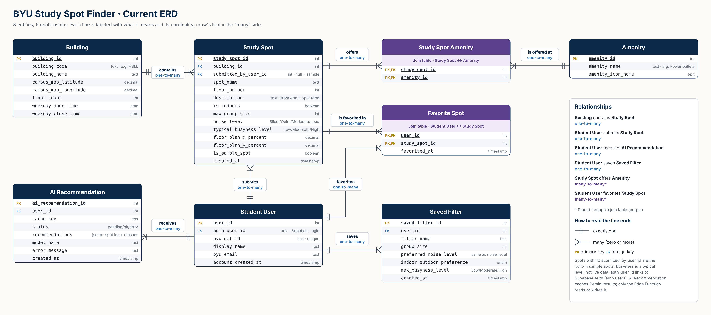

# BYU Study Spot Finder

**Live site:** https://jkooymann.github.io/BYU-Study-Spot-Finder/prototype/

## App Summary

Many BYU students struggle to find good places to study, especially during busy times when popular spots like the library are too crowded. Students often waste time walking around campus trying to find a spot that fits their needs, whether that's a quiet place, somewhere with outlets, an area for group studying, or some combination of the three. Our app solves this problem by helping BYU students quickly find study spots that match their preferences. Students can search for locations in different buildings and outdoors, and filter them by features such as noise level, busyness, group size, and available amenities. Students can browse spots on a campus map, save their favorite study spots to an account, add their own spots, and get AI suggestions for new spots based on the ones they already like. Ultimately, our goal is to help BYU students spend less time looking for somewhere to study and more time actually getting their work done.

## Features

- **Home:** pick what you want in a study spot (quiet, outlets, food allowed, indoors or outdoors, and more) and see the spots that match.
- **Campus Map:** a map of 23 campus buildings drawn from real building outlines. Click a building to see its floors (including basements) and where each study spot is. Outdoor spots sit on the campus map at their own location instead of inside a building.
- **Study Spot List:** every spot, with filters for group size, features, building, and indoors or outdoors, sorted by building or by least busy.
- **Spot Details:** opens over the page you came from, with the spot's features, how busy it usually is ("est."), and its place on the floor plan or campus map.
- **Accounts:** students create an account with their BYU Net ID and log in. Their name shows in the top corner, with a menu to log out. A **Forgot password** link emails a reset link (for now this works for team accounts only).
- **Favorites:** logged-in students tap the ★ on any spot to save it to their account.
- **Add a Spot:** logged-in students add a spot they know about: building (or outdoors), floor, location on the floor plan or map, group size, how busy it usually is, and features. It is saved to the Supabase database.
- **Private and shared spots:** spots a student adds are private (only that student sees them, with an "Only you" label). Spots added by the team's admin account are shared with everyone. The database enforces this, not just the page.
- **Admin account:** one team account (Jason's, `jkooyman`) is the admin. It can add shared spots, and it is the only account that can **edit** or **delete** shared spots (Edit spot and Delete sit together at the bottom of Spot Details). Students can delete only their own private spots.
- **OKR Trackers (admin only):** ☰ menu → OKR Trackers (`#okr`) shows live progress on our four OKRs:
  1. 80% of sessions under 10 minutes of active time (not counting each student's first session)
  2. 50% of users find a spot within 5 minutes
  3. At least 80% of users favorite one or more spots
  4. At least 30% of users with a favorite have one outside the library
- **✨ Suggest spots:** a button in the bottom-right corner uses AI (Google Gemini) to suggest 3–5 spots based on a student's favorites, each with a short reason. It shows "This could take up to 30 seconds…" while it loads.
- **Works on phones:** on small screens the Home / Map / List / Favorites tabs move to a bar at the bottom, and filters open as a bottom sheet.

## ERD



Note: this diagram is from October. Since then the database has also gained:

- `ai_recommendation` (saved AI suggestions) and `student_user.auth_user_id` (links each student to their login)
- `study_spot.is_shared` (private vs shared spots), `campus_map_x_percent` / `campus_map_y_percent` (outdoor spots' place on the campus map), and `building_id` is optional for outdoor spots
- `app_admin` (which account is the admin; only the SQL Editor can change it)
- `user_session` and `spot_search` (data for the OKR trackers)

The `seat_count` and `location_description` columns were removed from `study_spot`, and the app no longer uses spot ratings.

## Tech Stack

- **Frontend:** plain HTML, CSS and JavaScript (no build step), hosted on **GitHub Pages**. Every merge to `main` redeploys the live site automatically.
- **Backend:** Supabase (Auth for accounts and password resets, Row Level Security and database functions for permissions and the OKR numbers, and an Edge Function for AI suggestions)
- **Database:** Supabase (PostgreSQL). Schema changes live in `supabase/migrations/` and are run in Supabase's SQL Editor.
- **AI:** Google Gemini (free tier), called from the Supabase Edge Function so the Gemini key is never in the browser

We chose HTML/CSS/JS for our frontend because we worked primarily with Claude during our design sprint. It built a user-friendly frontend with HTML so we decided to continue on that route. We chose Supabase for the backend and database as we are most familiar with that service, and it is easiest to have the same service provide both. Supabase also handles our accounts and runs the small server function that talks to Gemini. We used ChatGPT and Claude to help connect each layer.

## How to Get It Running

To just use the site, open the [live site](https://jkooymann.github.io/BYU-Study-Spot-Finder/prototype/).

To run it on your own computer:

1. Clone the repository (or download it as a ZIP from GitHub) and open the folder in Visual Studio Code.
2. The Supabase URL and publishable key are already filled in at `prototype/js/supabase-config.js`.
3. Open `prototype/index.html` and click **Go Live** (VS Code's Live Server extension). The website opens in your browser. You can also run `python -m http.server 8000` inside the `prototype` folder and go to http://localhost:8000.
4. The Home, Map, List, and Favorites pages work without logging in. To save favorites or add spots, click **Log in** in the top-right corner and create an account.

**Database setup** (only the database owner does this, once per new file): run each SQL file in `supabase/migrations/`, in order, in Supabase's SQL Editor. The Suggest spots button also needs the `recommend-spots` Edge Function deployed with a `GEMINI_API_KEY` secret. Step-by-step notes are in [prototype/README.md](prototype/README.md).

## Verifying the Vertical Slice

1. Open the BYU Study Spot Finder website.
2. Click **Log in** in the top-right corner, then **Create an account**. Enter your name, BYU Net ID, and a password.
3. Supabase emails a confirmation link to your BYU email. Click it, then log in. Your name should appear in the top-right corner.
4. Find a study spot and click its ★ (favorite) button. The star fills in.
5. The app sends this to Supabase, which saves the favorite in the `favorite_spot` table with your student ID and the study spot's ID.
6. Refresh the page. The star is still filled in and the spot is listed on the Favorites page.
7. Click the star again to remove the favorite, refresh, and check that it is gone.

This shows that the frontend, backend, and database are all communicating, and that changes are saved to each student's account rather than just stored in the browser.

## Repository Layout

```
index.html                  Redirects the site root to prototype/
prototype/
  index.html                The single page shell
  css/styles.css            All styles (colors at the top, plus dark mode)
  js/
    supabase-config.js      Supabase URL and publishable key
    data.js                 Buildings, map outlines, and filter options (no spots: those come from the database)
    db.js                   The only file that talks to Supabase
    store.js                Favorites, added spots, and filter matching
    account.js              Create account, log in, forgot/reset password
    campus-map.js           Campus map and floor views
    components.js, pages.js Page building blocks and pages
    recommend.js            ✨ Suggest spots
    app.js                  Router and click handling
    okr/                    OKR trackers (see js/okr/README.md)
  tests/                    Browser tests (Playwright, Python)
supabase/
  migrations/               Database changes, run in the SQL Editor in order
  functions/recommend-spots Edge Function that calls Gemini
  seed.sql                  Starting data (buildings, amenities)
  tests/                    Database permission (RLS) tests
docs/erd/                   ERD image and the script that draws it
```

## Recent Updates

**November 11–18**

- Admin account: one team account adds shared spots and can edit or delete them; students' spots are private to them (Mallory, Jason).
- OKR Trackers page for the admin with all four OKRs, measured on active time and real student accounts only (Mallory, Jason).
- Forgot password / reset password, and clearer error messages on Create account and Log in (Mallory).
- Outdoor campus map: outdoor spots get their own place on the map, plus simpler maps and aligned building labels (Isaac).
- Team-checked floor lists with basement floors, and RB Cannon Center and the Music Building are now selectable (Isaac).
- New Home tab, simpler pages, a gold nav bar, and keeping your place when moving between map, buildings and floors (Jason).
- Home layout refresh with more room for filters, and phone navigation moved to the bottom of the screen (Isaac).
- The 26 old example spots were removed; every spot now comes from the database (Jason).
- Faster AI suggestions with a loading message (Jason).

**November 3–10**

- Accounts: Create account and Log in pages connected to Supabase Auth. New accounts are saved to the `student_user` table automatically.
- Favorites are saved per student account instead of for sample users picked from a dropdown.
- Add a Spot saves new spots to Supabase and includes a "how busy it usually is" picker.
- Added the ✨ Suggest spots button with AI recommendations from Google Gemini (Evan fixed its database query).
- Redrew the Campus Map from real campus building outlines and added more buildings, including the Arts Building, Life Sciences Building, and Engineering Building (Isaac).
- UI updates: a ☰ menu, the same filters on every page, and a matching header on every page.
- Removed the Saved filters tab from the Favorites page and the star ratings on study spots.

## Team and Contributing

Built by Jason Kooyman, Mallory Rich, Isaac Sushoreba, and Evan Anderson for a BYU course.

We use a branch + pull request workflow, and nobody pushes straight to `main`. See [CONTRIBUTING.md](CONTRIBUTING.md).
