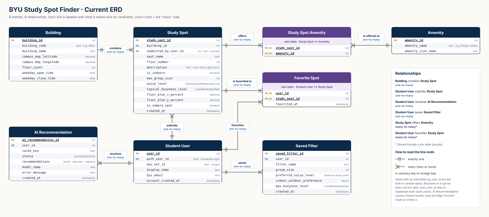

BYU STUDY SPOT FINDER

App Summary:

Many BYU students struggle to find good places to study, especially during busy times when popular spots like the library are too crowded. Students often waste time walking around campus trying to find a spot that fits their needs, whether that's a quiet place, somewhere with outlets, an area for group studying, or some combination of the three. Our app solves this problem by helping BYU students quickly find study spots that match their preferences. Students can search for locations in different buildings and filter them based on features such as noise level, busyness, group size, and available amenities. Students can also add new locations that other students might not know about, browse spots on a campus map, save their favorite study spots to an account, and get AI suggestions for new spots based on the ones they already like. Ultimately, our goal is to help BYU students spend less time looking for somewhere to study and more time actually getting their work done.

Features:
- Get Started: pick what you want in a study spot (quiet, outlets, food allowed, indoors or outdoors, and more) and see the spots that match.
- Campus Map: an illustrated map of 20 campus buildings. Click a building to see its floors and where each study spot is.
- Study Spot List: every spot, with filters for group size, features, building, and indoors or outdoors, sorted by building or by least busy.
- Accounts: students create an account with their BYU Net ID and log in. Their name shows in the top corner, with a menu to log out.
- Favorites: logged-in students tap the ★ on any spot to save it to their account.
- Add a Spot: logged-in students can add a spot they know about (building, floor, location on the floor plan, group size, how busy it usually is, and features). Everyone sees spots added by other students, and only the person who added a spot can delete it.
- ✨ Suggest spots: a button in the bottom-right corner uses AI (Google Gemini) to suggest 3–5 spots based on a student's favorites, each with a short reason.

ERD:

Note: this diagram is from October. Since then the database also has an ai_recommendation table (saved AI suggestions) and an auth_user_id column on student_user (links each student to their login). The seat_count and location_description columns were removed from study_spot. The app no longer uses spot ratings.

Tech Stack:

Frontend: HTML/CSS/JS
Backend: Supabase (Auth for accounts, an Edge Function for AI suggestions)
Database: Supabase (PostgreSQL)
AI: Google Gemini (free tier), called from the Supabase Edge Function

We chose HTML/CSS/JS for our frontend because we worked primarily with Claude during our design sprint. It built a user-friendly frontend with HTML so we decided to continue on that route. We chose Supabase for the backend and database as we are most familiar with that service. We believe it will be easiest to have the same service provide both. Supabase also handles our accounts (Supabase Auth) and runs the small server function that talks to Gemini, so the Gemini key is never in the browser. We used ChatGPT and Claude to help connect each layer.

How to Get It Running:
- Open our team's GitHub repository using the provided link.
- Download the project files or clone the repository to your computer.
- Open the project folder in Visual Studio Code.
- The Supabase URL and publishable key are already filled in at prototype/js/supabase-config.js.
- Open prototype/index.html and start a local web server using VS Code's Live Server extension by clicking “Go Live”. The website opens in your browser.
- The website should open on the Get Started page. The Map, List, and Favorites pages all work without logging in. To save favorites or add spots, click Log in in the top-right corner and create an account.
- Database setup (only the database owner does this once): every SQL file in supabase/migrations needs to be run in Supabase's SQL Editor, and the Suggest spots button needs its Edge Function deployed with a GEMINI_API_KEY secret. Step-by-step instructions are in prototype/README.md.

Verifying the Vertical Slice:
- Open the BYU Study Spot Finder website.
- Click Log in in the top-right corner, then Create an account. Enter your name, BYU Net ID, and a password.
- Supabase emails a confirmation link to your BYU email. Click it, then log in. Your name should appear in the top-right corner.
- Find a study spot and click the ★ (favorite) button on it.
- The star should fill in to show that the study spot has been favorited.
- The app sends this information to Supabase, where the favorite is saved in the favorite_spot table with your student ID and the study spot's ID.
- Refresh the webpage and check that the star is still filled in and the spot is listed on the Favorites page.
- Click the star again to remove the study spot from your favorites.
- Refresh the page again to verify that the study spot is no longer favorited.
- This demonstrates that the frontend, backend, and database are all communicating successfully, and that changes are permanently saved to each student's account rather than just temporarily stored in the browser.

Recent Updates (November 3–10):
- Accounts: added Create account and Log in pages connected to Supabase Auth. New accounts are saved to the student_user table automatically. The Log in button sits in the top bar, so the rest of the site works without an account.
- Favorites are now saved per student account instead of for sample users picked from a dropdown.
- Add a Spot saves new spots to Supabase so the whole team sees them, and now includes a "how busy it usually is" picker.
- Added the ✨ Suggest spots button with AI recommendations from Google Gemini.
- Redrew the Campus Map from real campus building outlines, added more buildings (including the Arts Building, Life Sciences Building, and Engineering Building), and used each building's outline for its floor views.
- UI updates: a ☰ menu, the same filters on every page, and a matching header on every page.
- Removed the Saved filters tab from the Favorites page and the star ratings on study spots.
